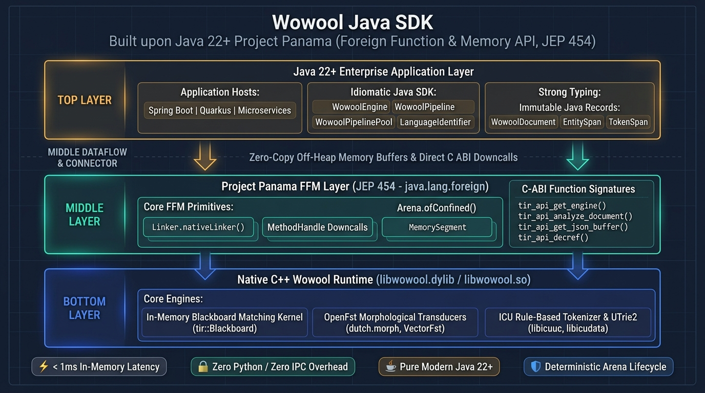
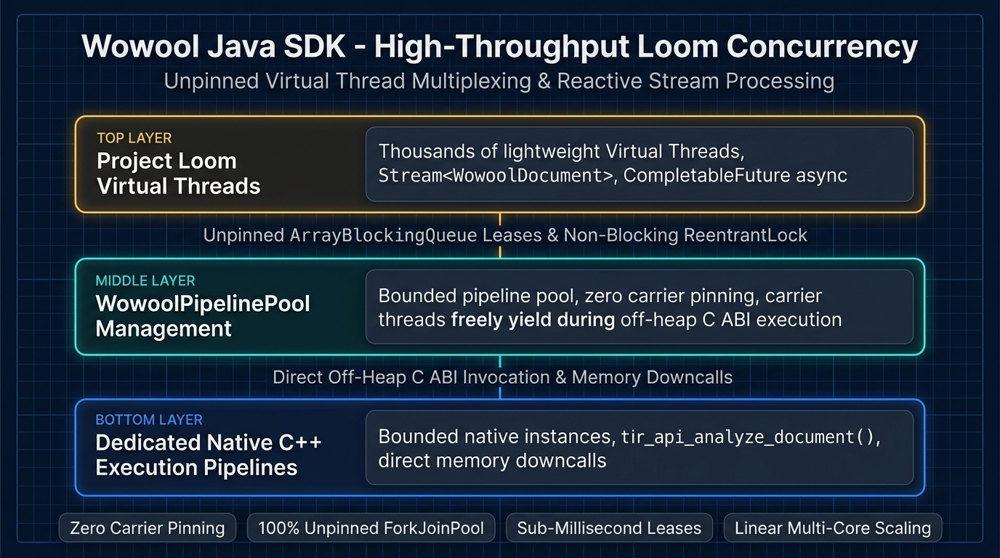

# Wowool Java SDK

[](https://github.com/rikdoclo/wowool-java-sdk/actions/workflows/ci.yml?query=branch%3Amain)
[](https://doi.org/10.5281/zenodo.23441610)
[-orange.svg)](https://openjdk.org/)
[](LICENSE)
[](https://wowool.com)
[](https://github.com/rikdoclo/wowool-java-sdk)

High-performance, idiomatic native **Java SDK for the Wowool NLP & Linguistic Engine**, built on **Project Panama** (the Foreign Function & Memory API - JEP 454 / Java 22+).

This SDK connects directly to the underlying C++ runtime (`libwowool.3.3.2.dylib` / `libwowool.so`) via the official C ABI (`tir_api_*`), delivering **pure in-memory NLP analysis in ~1 millisecond with zero Python runtime and zero IPC overhead**.

> 📖 **Academic Research Paper:** For the full theoretical foundations, micro-architecture, and Panama FFM benchmark evaluation, see the published paper:  
> **"Wowool: High-Throughput Deterministic Symbolic NLP with Multi-Language C-ABI and Project Panama FFM Interoperability"** (Doclo, Forest, Rubio De Hita, Grine, 2026).  
> **Permanent DOI:** [https://doi.org/10.5281/zenodo.23441610](https://doi.org/10.5281/zenodo.23441610) | **Zenodo Record:** [https://zenodo.org/records/23441610](https://zenodo.org/records/23441610)

---

## Key Features

- ⚡ **Sub-Millisecond Execution:** Direct C ABI downcalls with near zero-copy memory semantics via Panama `Arena` (< 1ms per document).
- 🧵 **Project Loom Virtual Threads & Streams:** First-class unpinned Virtual Thread batch and stream analysis via `WowoolPipelinePool`.
- 📐 **Type-Safe Fluent Rule DSL (`com.wowool.sdk.rule`):** Declarative, compile-time checked Java builder for Wowool DSL rules without string concatenation.
- 📍 **Rich Spatial & Linguistic Navigation:** Fast document navigation: `tokensBefore`, `tokensAfter`, `window`, `overlapping`, and lemma/POS filter queries.
- ☕ **100% Pure Modern Java 22+:** Zero external runtime dependencies in core, no JNI boilerplate, no C++ compilation required.
- 🔒 **Type-Safe Linguistic Model:** Sealed `Annotation` hierarchy (`TokenSpan`, `EntitySpan`, `SentenceSpan`) enabling exhaustive pattern matching and attribute extraction.
- 🧠 **Deterministic NLP:** Full access to Wowool's linguistic layers: deep morphology, Part-of-Speech tagging, tokenization, lemmatization, and cascading entity extraction.
- ⚙️ **Dynamic Rule Compilation:** Compile structured rules or raw `.wow` / `.woc` source files directly to binary `.dom` domains from Java.
- 🌐 **Instant Language Identification:** Integrated native `LanguageIdentifier` capable of detecting languages in sub-millisecond calls.
- 🔄 **Safe Lifecycle Management:** Full `AutoCloseable` implementation with deterministic off-heap native memory cleanup.
- 📐 **Normalized Systems Theory (NST) Alignment:** Engineered to eliminate combinatorial effects through strict Separation of Concerns (SoC), Data/Action Version Transparency (DVT/AVT), and complete Separation of States (SoS).
- 🔍 **Resilient Multi-Platform Discovery & Diagnostics:** Intelligent Darwin/Linux architecture probing with rich, actionable diagnostics if native libraries or models are missing.

---

## Architecture Overview



---

## Requirements

1. **Java 22 or higher** (Tested on OpenJDK 22, 23, 24, 25 LTS, and 26).
2. **Wowool Native Libraries & Models:** `libwowool`, `libicudata`, `libicuuc`, and `.language`/`.dom` files.
3. **JVM Flag:** `--enable-native-access=ALL-UNNAMED` (required by Java runtime for Project Panama Foreign Function access).

---

## Installation & Getting Started

### 1. Add Dependency to Your Project

Add the dependency to your project's `pom.xml` (or build tool):

```xml
<dependency>
    <groupId>com.wowool</groupId>
    <artifactId>wowool-sdk-java</artifactId>
    <version>2.1.0</version>
</dependency>
```

### 2. Zero-Configuration Native Engine Provisioning (Developers & Local VM)

The SDK provides automated on-demand provisioning for developer workstations:
* **No Python, pip, or virtual environment is ever required.**
* When `WowoolEngine.create()` runs for the first time, if native libraries or language models are absent, the SDK automatically downloads and unpacks the appropriate native engine (`libwowool.*`) and models directly into `~/.wowool`.
* Once installed, all subsequent starts load instantaneously in sub-millisecond time.

To manually pre-download or install specific language models:
```bash
# Using Java:
java -cp wowool-sdk-java-2.1.0.jar com.wowool.sdk.installer.WowoolInstaller --languages=dutch

# Or using the standalone shell script:
./scripts/install-wowool.sh --target=$HOME/.wowool --languages=dutch
```

### 3. Production Kubernetes & Enterprise OCI Container Images (Pre-Baked)

In enterprise production Kubernetes environments, pods operate strictly immutable with zero external internet access at runtime. Native binaries and models should be pre-baked into the container image layer during `docker build`:

```dockerfile
FROM eclipse-temurin:25-jre

# Pre-bake Linux native binaries and models into /opt/wowool (Zero Python required)
RUN ./scripts/install-wowool.sh --target=/opt/wowool --platform=linux-x86_64 --languages=dutch

# Configure standard Wowool paths for offline pod execution
ENV WOWOOL_ROOT=/opt/wowool
ENV WOWOOL_DYLIB_DIR=/opt/wowool/lib

COPY target/my-service.jar /app/my-service.jar

# Run with Project Panama native access permission
ENTRYPOINT ["java", "--enable-native-access=ALL-UNNAMED", "-jar", "/app/my-service.jar"]
```

### 4. Commercial License Key Configuration

Set your commercial Wowool SDK key via any standard mechanism:
1. Environment Variable: `export WOWOOL_SDK_KEY="your-license-key"` (or Kubernetes Secret)
2. Java System Property: `-Dwowool.license.key="your-license-key"`
3. User Configuration: `~/.config/wowool/WOWOOL_SDK_KEY`

---

## Quickstart

### 1. Linguistic Analysis & Entity Recognition

```java
import com.wowool.sdk.WowoolEngine;
import com.wowool.sdk.WowoolPipeline;
import com.wowool.sdk.model.Annotation;
import com.wowool.sdk.model.EntitySpan;
import com.wowool.sdk.model.TokenSpan;
import com.wowool.sdk.model.WowoolDocument;

public class Quickstart {
    public static void main(String[] args) {
        // Initialize engine (automatically discovers license key & models)
        try (WowoolEngine engine = WowoolEngine.create()) {

            // Create pipeline with language 'english' and domain 'entity'
            try (WowoolPipeline pipeline = engine.pipeline("english", "entity")) {

                String text = "Satya Nadella spoke at Microsoft headquarters in Redmond.";
                WowoolDocument doc = pipeline.analyze(text);

                System.out.printf("Sentences: %d | Tokens: %d | Entities: %d%n",
                    doc.sentenceCount(), doc.tokenCount(), doc.entityCount());

                // Iterate over all extracted entities
                for (EntitySpan entity : doc.entities()) {
                    System.out.printf("  [%s] '%s' (%d-%d) -> %s%n",
                        entity.uri(),
                        entity.literal(),
                        entity.beginOffset(),
                        entity.endOffset(),
                        entity.attributes());
                }

                // Polymorphic annotation traversal with Java 22+ pattern matching
                for (Annotation ann : doc.annotations()) {
                    switch (ann) {
                        case TokenSpan token   -> System.out.printf("  [Token] %s (POS: %s)%n", token.text(), token.pos());
                        case EntitySpan entity -> System.out.printf("  [Entity: %s] %s -> %s%n", entity.uri(), entity.text(), entity.canonical());
                        case SentenceSpan s    -> {}
                    }
                }

                // Filter specifically for Person entities
                for (EntitySpan person : doc.entities("Person")) {
                    System.out.println("Found person: " + person.literal());
                }
            }
        }
    }
}
```

---

### 2. Sub-Millisecond Language Identification

```java
import com.wowool.sdk.WowoolEngine;
import com.wowool.sdk.LanguageIdentifier;

try (WowoolEngine engine = WowoolEngine.create();
     LanguageIdentifier lid = engine.languageIdentifier()) {

    String lang1 = lid.identify("This is an English technical document.");
    String lang2 = lid.identify("Ceci est un document rédigé en français.");
    String lang3 = lid.identify("Dit is een Nederlandstalige juridische tekst.");

    System.out.println(lang1); // english
    System.out.println(lang2); // french
    System.out.println(lang3); // dutch
}
```

---

### 3. Type-Safe Fluent Rule DSL (`com.wowool.sdk.rule`)

Compile expressive, structured rules directly into binary `.dom` domains without string concatenation:

```java
import com.wowool.sdk.WowoolEngine;
import com.wowool.sdk.WowoolPipeline;
import com.wowool.sdk.DomainCompiler;
import com.wowool.sdk.CompilationResult;
import com.wowool.sdk.model.WowoolDocument;
import com.wowool.sdk.rule.*;

import java.nio.file.Path;

try (WowoolEngine engine = WowoolEngine.create()) {
    DomainCompiler compiler = engine.compiler();

    // Declarative, compile-time checked rule builder
    WowoolRule rule = WowoolRule.named("ExtractEmployment")
        .matching(Sequence.of(
            Patterns.concept("Person"),
            Patterns.gap(),
            Patterns.choice("employed", "works"),
            Patterns.literal("at"),
            Patterns.gap(),
            Patterns.concept("Organization")
        ))
        .yields("EmploymentRelation");

    Path targetDom = Path.of("target/employment_rules.dom");
    CompilationResult result = compiler.compileRule(rule, targetDom, "english");

    if (result.success()) {
        try (WowoolPipeline pipeline = engine.pipeline("english", "entity", targetDom.toString())) {
            WowoolDocument doc = pipeline.analyze("Satya Nadella works at Microsoft.");
            doc.findFirst("EmploymentRelation").ifPresent(match ->
                System.out.println("Extracted: " + match.literal())
            );
        }
    }
}
```

---

### 4. Virtual Threads (Project Loom) & Stream Processing



High-throughput, unpinned Virtual Thread batch and stream analysis across pooled pipelines:

```java
import com.wowool.sdk.WowoolEngine;
import com.wowool.sdk.WowoolPipelinePool;
import com.wowool.sdk.model.WowoolDocument;

import java.util.List;
import java.util.stream.Stream;

try (WowoolEngine engine = WowoolEngine.create();
     WowoolPipelinePool pool = engine.pool("dutch", 8, "entity")) {

    // 1. Concurrent batch analysis with unpinned Virtual Threads
    List<String> batch = List.of(
        "Jan Janssen woont in Amsterdam.",
        "Willem-Alexander bezoekt Rotterdam."
    );
    List<WowoolDocument> docs = pool.analyzeBatch(batch);

    // 2. Stream processing
    Stream<String> stream = Stream.of("Eerste document...", "Tweede document...");
    pool.analyzeStream(stream).forEach(doc ->
        System.out.printf("Tokens: %d, Entities: %d%n", doc.tokenCount(), doc.entityCount())
    );

    // 3. Asynchronous non-blocking analysis
    pool.analyzeAsync("Jan bezoekt Utrecht.").thenAccept(doc ->
        System.out.println("Async entities: " + doc.entityCount())
    );
}
```

---

### 5. Rich Spatial & Linguistic Navigation

Intuitive spatial windowing and linguistic query extensions directly on `WowoolDocument`:

```java
WowoolDocument doc = pipeline.analyze("De bekende wetenschapper Albert Einstein werd geboren in Ulm.");

EntitySpan einstein = doc.findFirst("Person").orElseThrow();

// Contextual spatial navigation
List<TokenSpan> before2 = doc.tokensBefore(einstein, 2); // ["bekende", "wetenschapper"]
List<TokenSpan> after2  = doc.tokensAfter(einstein, 2);  // ["werd", "geboren"]
List<TokenSpan> window  = doc.window(einstein, 1);       // 1 before + inside + 1 after

// Linguistic filtering
List<TokenSpan> verbs = doc.tokensByPos("Verb");
List<TokenSpan> matchingLemmas = doc.tokensByLemma("geboren");
List<String> allLemmas = doc.lemmas();
```

---

## Configuration & Environment Variables

The SDK automatically resolves paths using standard conventions, but can be overridden:

| Environment Variable | Java System Property | Description | Default / Discovery Order |
| :--- | :--- | :--- | :--- |
| `WOWOOL_SDK_KEY` | `wowool.license.key` | Commercial license key | `~/.config/wowool/WOWOOL_SDK_KEY` |
| `WOWOOL_DYLIB_DIR` | `wowool.dylib.dir` | Folder containing native dynamic libraries | `~/.wowool/lib`, `./native/dylibs`, active `$VIRTUAL_ENV`, `/opt/wowool/lib`, `/usr/local/lib/wowool` |
| `WOWOOL_ROOT` | `wowool.root` | Folder containing `lxware/wowool` models | `~/.wowool/models`, `./native/wowool`, active `$VIRTUAL_ENV`, `/opt/wowool`, `/usr/share/wowool` |

### Explicit Configuration via Builder

```java
WowoolConfig config = WowoolConfig.builder()
    .licenseKey("YOUR_COMMERCIAL_KEY")
    .dylibDir(Path.of("/opt/wowool/lib"))
    .wowoolRoot(Path.of("/opt/wowool/models"))
    .build();

try (WowoolEngine engine = WowoolEngine.create(config)) {
    // ...
}
```

### Standard Local Discovery Setup (macOS / Linux / WSL2)

To run the SDK locally on your workstation or standalone server without setting environment variables:

```bash
# 1. Create standard directory layout
mkdir -p ~/.wowool/lib ~/.wowool/models/lxware/wowool ~/.config/wowool

# 2. Place native libraries (.dylib on macOS, .so on Linux) and models
cp /path/to/libwowool.* ~/.wowool/lib/
cp -r /path/to/models/* ~/.wowool/models/lxware/wowool/

# 3. Store license key
echo "YOUR_COMMERCIAL_SDK_KEY" > ~/.config/wowool/WOWOOL_SDK_KEY
```

For complete OS-specific guides (including Ubuntu/Debian ICU dependencies, RHEL/Fedora, Windows WSL2, and zero-config `./native` team repository layouts), see the [Developer Guide](docs/DEVELOPER_GUIDE.md#6-resilient-multi-platform-discovery--diagnostics).

---

## Empirical Performance & Panama FFM Benchmarks

Empirical performance benchmark results on Apple Silicon (12 cores) with Java 22 Panama FFM API (direct C ABI downcalls, zero heap bloat):

### Single-Thread Hot Path Latency & Throughput
| Pipeline Configuration | Document Chars | Tokens | Mean Latency (ms) | P90 Latency (ms) | Throughput (Tokens/s) |
| :--- | :---: | :---: | :---: | :---: | :---: |
| **Tokenize + POS (Short)** | 109 | 17 | **0.26 ms** | 0.31 ms | **65,000+** |
| **Tokenize + POS (Medium)** | 4,150 | 650 | **2.67 ms** | 2.90 ms | **243,000+** |
| **Tokenize + POS (Long)** | 20,758 | 3,250 | **11.92 ms** | 12.35 ms | **272,000+** |
| **Full NER + POS (Short)** | 109 | 17 | **0.87 ms** | 0.95 ms | **19,500+** |
| **Full NER + POS (Medium)** | 4,150 | 650 | **20.38 ms** | 21.10 ms | **31,800+** |

### Multi-Core Linear Scaling Profile (`WowoolPipelinePool`)
| Active Worker Threads | Total Processed Documents | Aggregate Throughput | Speedup Factor |
| :---: | :---: | :---: | :---: |
| **1 Thread** | 25 | 31,881 tokens/s | **1.00x** (baseline) |
| **2 Threads** | 50 | 56,202 tokens/s | **1.76x** |
| **4 Threads** | 100 | 105,711 tokens/s | **3.32x** |
| **8 Threads** | 200 | 186,846 tokens/s | **5.86x** |
| **12 Threads** | 300 | 216,111 tokens/s | **6.78x** |

---

## Testing

Run the automated test suite:

```bash
mvn test
```

---

## Documentation

For in-depth architecture, memory management, and enterprise integration patterns, see:
- [Developer Guide & Architecture](docs/DEVELOPER_GUIDE.md)
- [Changelog & Release History](CHANGELOG.md)

---

## Academic Research & Citation

If you use the Wowool Java SDK or its empirical benchmarks in your research, please cite the published academic paper:

> **"Wowool: High-Throughput Deterministic Symbolic NLP with Multi-Language C-ABI and Project Panama FFM Interoperability"**  
> Rik Doclo, Philippe Forest, Manuel Rubio De Hita, Nadir Grine (2026).  
> **Permanent DOI:** [https://doi.org/10.5281/zenodo.23441610](https://doi.org/10.5281/zenodo.23441610) | **Zenodo Record:** [https://zenodo.org/records/23441610](https://zenodo.org/records/23441610)

```bibtex
@article{doclo2026wowool,
  title={{Wowool: High-Throughput Deterministic Symbolic NLP with Multi-Language C-ABI and Project Panama FFM Interoperability}},
  author={Doclo, Rik and Forest, Philippe and Rubio De Hita, Manuel and Grine, Nadir},
  year={2026},
  month={10},
  publisher={Zenodo},
  doi={10.5281/zenodo.23441610},
  url={https://doi.org/10.5281/zenodo.23441610}
}
```

---

## Contributing & Support

- **Repository:** [https://github.com/rikdoclo/wowool-java-sdk](https://github.com/rikdoclo/wowool-java-sdk)
- **Issues & Bug Reports:** [GitHub Issues](https://github.com/rikdoclo/wowool-java-sdk/issues)

Pull requests and issues are welcome!

---

## License

Copyright (c) 2026 Rik Doclo. All rights reserved.  
Licensed under the Apache License, Version 2.0. See [LICENSE](LICENSE) for details.
